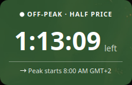
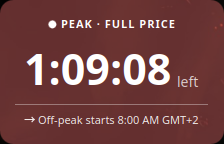

# DeepSeek Hours Clock

A KDE Plasma 5 desktop widget that shows the current DeepSeek API
peak/off-peak tariff, a live countdown to the next tariff change, and the
current prices — with a background that turns green during off-peak and red
during peak hours.

| Off-peak | Peak |
| :---: | :---: |
|  |  |

## Features

- Live countdown to the next peak/off-peak switch.
- Background tinted green (off-peak) or red (peak), with configurable opacity.
- Shows when the next period starts, in your local time zone (`GMT+X`).
- Peak schedule is based on DeepSeek's official UTC windows, Monday–Friday.
- Full pricing (cache-hit, cache-miss, output) shown in a tooltip on hover.
- Configurable model presets, prices, peak hours and text alignment.

## Requirements

- Plasma 5.27 or newer (KDE Frameworks 5).
- `kpackagetool5` (part of `kpackage`/`plasma-framework`).

## Installation

### From source

```sh
git clone https://github.com/EfoneMax/kde-deepseek-hours.git
cd kde-deepseek-hours
kpackagetool5 --type Plasma/Applet --install .
```

Then right-click the desktop (or panel) → **Add Widgets…**, search for
**DeepSeek Hours Clock** and add it.

### Updating

```sh
cd kde-deepseek-hours
git pull
kpackagetool5 --type Plasma/Applet --upgrade .
```

After updating, remove and re-add the widget (or restart plasmashell) so the
new QML is loaded.

### Removing

```sh
kpackagetool5 --type Plasma/Applet --remove io.github.efonemax.deepseekhours
```

## Usage

The widget shows:

- a colored dot and status line (`OFF-PEAK · HALF PRICE`, or `OFF-PEAK · WEEKEND` / `OFF-PEAK · SPRING FESTIVAL` when the discount is due to a weekend or a Chinese public holiday; `PEAK · FULL PRICE` during peak),
- a large countdown (`H:MM:SS`) until the tariff changes,
- a line telling you when the next period starts, in local time,
- all current prices in a tooltip when you hover over the widget.

## Configuration

Right-click the widget → **Configure** → **General**:

| Option | Description |
| --- | --- |
| **Model** | `deepseek-flash`, `deepseek-v4-pro`, or `custom`. Selecting a model fills in its published prices. |
| **Background opacity** | Tint opacity, 0–100%. |
| **Text alignment** | Align the whole text block left, center or right. |
| **Peak hours (UTC)** | Comma-separated UTC hour ranges with an **exclusive end**, e.g. `1-4,6-10` means 01:00–04:00 and 06:00–10:00. A single number is one hour; ranges may wrap past midnight (`22-3`). |
| **Peak hours Monday-Friday only** | DeepSeek charges peak rates on weekdays only; weekends are fully off-peak. |
| **Chinese public holidays are off-peak all day** | Chinese public holidays (Beijing calendar) are fully off-peak. Holiday dates are encoded for 2026–2032. Make-up workdays (调休) on weekends do **not** become peak — DeepSeek bills every weekend at the off-peak rate. |
| **Prices** | Cache-hit input, cache-miss input and output, for peak and off-peak, in USD per 1M tokens. Used in the tooltip. |
| **Reset to deepseek-flash defaults** | Restores the model, schedule and prices to the built-in defaults. |

## DeepSeek pricing reference

The defaults in this widget follow DeepSeek's published pricing:

- **Peak hours:** 01:00–04:00 and 06:00–10:00 UTC, **Monday–Friday**, excluding Chinese public holidays.
- **Off-peak:** all other times, including the whole weekend and all Chinese public holidays.
- **Off-peak rates are half of peak rates.**

Chinese public holidays follow the State Council calendar (Beijing time). The
holiday dates are encoded for **2026–2032**; only 2026 is officially published,
later years are estimated from the standing 放假 rules. Make-up workdays
(调休) are ignored on purpose: DeepSeek bills every weekend as off-peak
regardless of the office calendar.

Default prices for `deepseek-flash` (USD per 1M tokens):

| | Peak | Off-peak |
| --- | --- | --- |
| Input (cache hit) | $0.006 | $0.003 |
| Input (cache miss) | $0.30 | $0.15 |
| Output | $1.20 | $0.60 |

Prices and the schedule may change. Always check the official page:
<https://api-docs.deepseek.com/quick_start/pricing>. You can edit all of these
values in the widget settings.

## Development

The widget is a plain QML plasmoid (no build step). To try changes:

```sh
# after editing files
kpackagetool5 --type Plasma/Applet --upgrade .
```

To reload it while plasmashell is running, remove and re-add the widget, or
restart plasmashell:

```sh
plasmashell --replace &
```

## License

GPL-3.0-or-later. See [LICENSE](LICENSE).

## Acknowledgments

The Chinese public holiday schedule is based on the reference implementation
[AutonomoAI/DSHours](https://github.com/AutonomoAI/DSHours) and the official
DeepSeek pricing page.

## Disclaimer

This is an unofficial, community-made widget. It is not affiliated with or
endorsed by DeepSeek. Pricing and schedule information is provided as a
convenience and may be out of date — verify it against the official DeepSeek
documentation.
